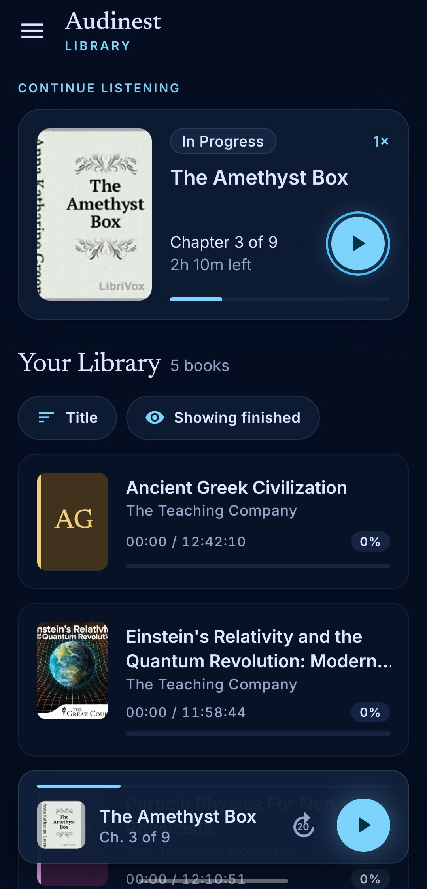
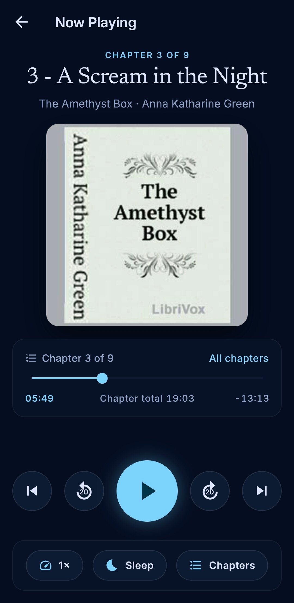
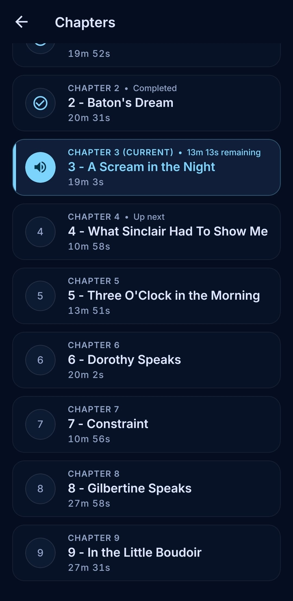
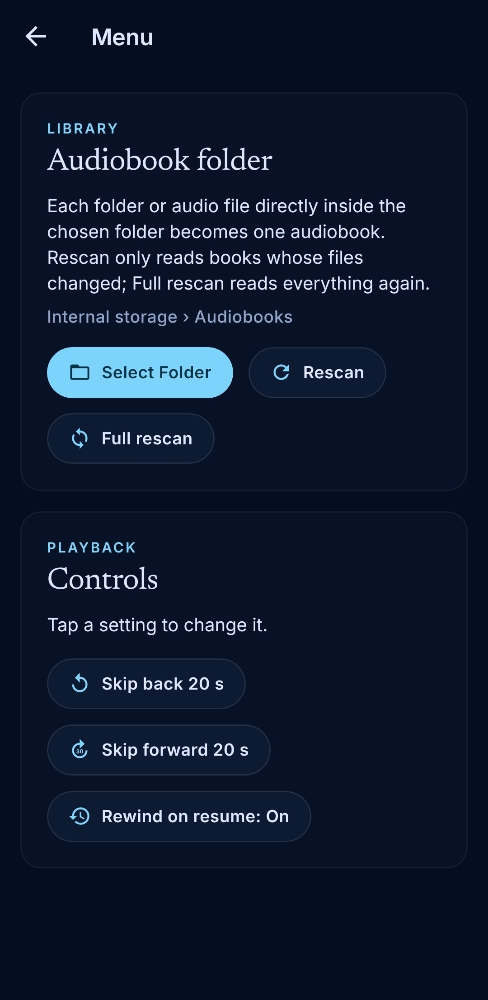

AudiNest
========

An audiobook player for Android built with [Expo](https://expo.dev) and React Native.

Pick a folder, and every audio file or folder of audio files directly inside it becomes an
audiobook. M4B chapters are read from the file. Your position in each book is remembered.

<p align="center">
  &emsp;
  &emsp;
  &emsp;
  
</p>

AudiNest is derived from [native-audiobook-player](https://github.com/lokdevp/native-audiobook-player),
an earlier project by the same author.

### Features

**Library**

- Pick a folder once; each audio file or folder of audio files inside it becomes a book
- Single-file M4B books with embedded chapters, and folder books with one chapter per file
- Title, author (from the album artist / artist tag) and cover art read from the files
- Sort by title, recently played or progress, and optionally hide finished books
- Long-press a book to mark it finished or reset its progress
- Fast rescans that skip unchanged books, plus a full rescan option
- Resume card and mini player to jump back into the current book

**Playback**

- Position saved per book, kept across rescans
- Chapter list with jump to any chapter, and a "Back to …" button to undo a jump or seek
- Adjustable skip back / forward lengths (10–60 s)
- Rewind on resume: goes back 5–30 s depending on how long playback was paused
- Playback speed from 0.75× to 2×, remembered per book
- Sleep timer: 15/30/45/60 minutes (with a fade-out) or end of chapter
- Background playback and lock-screen controls (dev/release builds)

### Running

```sh
pnpm install
pnpm start          # then scan the QR code with Expo Go on an Android phone
```

The app only uses modules bundled with Expo Go. Background playback and lock-screen controls
need a development or release build. In Expo Go, Android stops the audio about 3 minutes after
the app leaves the screen, so use a build for real listening:

```sh
npx expo run:android                              # local dev build (needs the Android SDK)
npx eas-cli@latest build --platform android       # cloud build
```

The `android/` folder is generated by `expo prebuild` and isn't committed.

### Development

```sh
pnpm test           # Jest (jest-expo)
pnpm typecheck      # tsc --noEmit
pnpm lint           # expo lint
```

### License

Copyright (C) 2026 Lokesh Devasenapathi

AudiNest is free software: you can redistribute it and/or modify it under the terms of the
[GNU General Public License](LICENSE) as published by the Free Software Foundation, either
version 3 of the License, or (at your option) any later version.
